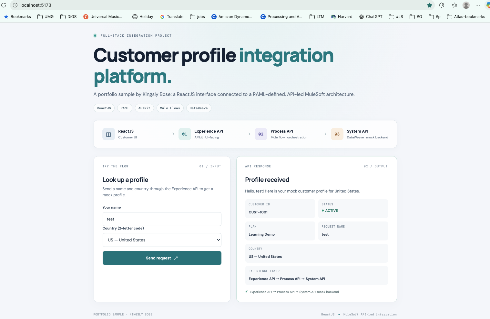
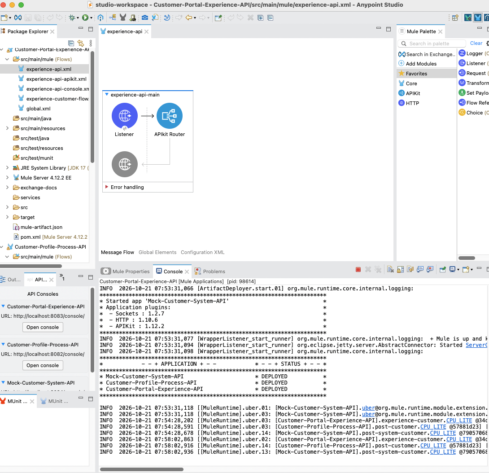
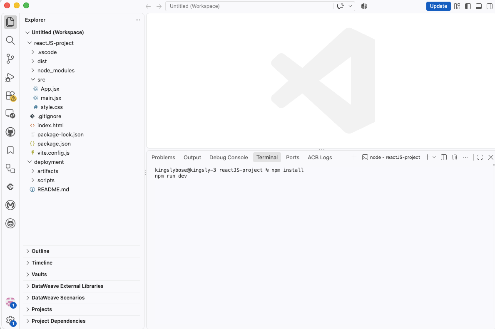
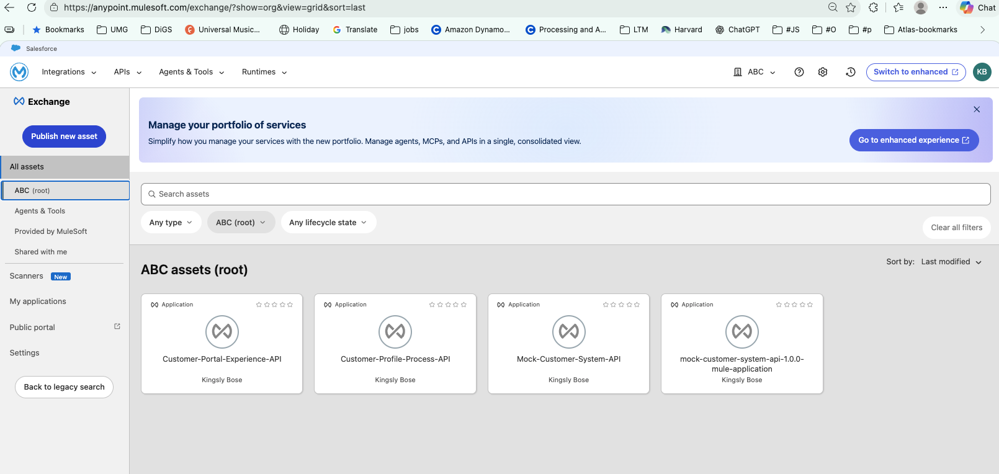
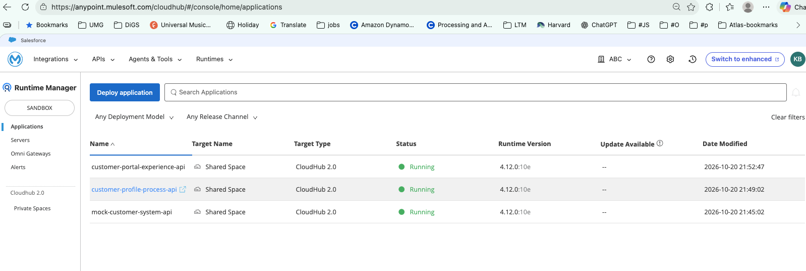

# MuleSoft Customer Profile API Platform

## A portfolio sample by Kingsly Bose

A ReactJS customer experience connected to a MuleSoft API-led architecture. A lookup travels through the Experience, Process, and mock System APIs. The APIs use RAML 1.0 contracts, APIkit routing, Mule flows, and DataWeave transformations.

**ReactJS · RAML 1.0 · APIkit · Mule Runtime · Mule Flows · DataWeave · Anypoint Studio · Exchange · CloudHub 2.0**

> The System API returns mock data. This sample does not connect to a live Salesforce org or contain real customer records.



*Portfolio UI showing a customer lookup and the three-layer MuleSoft request path.*

## Contents

- [Project overview](#project-overview)
- [Architecture and request flow](#architecture-and-request-flow)
- [Project layout](#project-layout)
- [Prerequisites](#prerequisites)
- [Run locally](#run-locally)
- [Test the APIs](#test-the-apis)
- [Implementation map](#implementation-map)
- [Troubleshooting](#troubleshooting)
- [Build, publish, and deploy](#build-publish-and-deploy)
- [Exchange and CloudHub evidence](#exchange-and-cloudhub-evidence)
- [Portfolio scope](#portfolio-scope)

## Project overview

The sample demonstrates a customer profile lookup from the browser through three MuleSoft API layers. The ReactJS screen submits a name and two-letter country code. The Experience API accepts the UI request, the Process API orchestrates the lookup and resolves the country name, and the System API returns a mock customer profile.

### Skills and technologies highlighted

| Technology | Role in this sample |
| --- | --- |
| ReactJS + Vite | Customer lookup interface, response presentation, and local development server |
| RAML 1.0 | Contract-first definitions for API resources, request/response structures, and examples |
| APIkit | Routes requests to flows based on each RAML contract |
| Mule Runtime + Mule flows | Runs the Experience, Process, and mock System APIs and coordinates requests |
| DataWeave | Normalizes inputs, resolves country names, and maps JSON responses |
| Anypoint Studio | Imports, runs, and inspects the Mule applications locally |
| Anypoint Exchange | Publishes and discovers API specifications and application assets |
| CloudHub 2.0 | Demonstrates a dependency-ordered deployment workflow |

## Architecture and request flow

```text
ReactJS + Vite (localhost:5173)
         │ POST /api/customer
         ▼
Experience API (localhost:8083)
  UI-facing entry point; validates and adapts the request/response
         │ HTTP POST /api/customer
         ▼
Process API (localhost:8082)
  Orchestrates lookup; resolves country name and builds downstream request
         │ HTTP POST /api/customer
         ▼
Mock System API (localhost:8084)
  Returns a fictional customer profile

Response flows back: System → Process → Experience → ReactJS
```

| Layer | Responsibility in the sample |
| --- | --- |
| ReactJS UI | Collects a name and country code, sends JSON, and renders the response. |
| Experience API | Exposes the UI-facing endpoint; APIkit routes the request and DataWeave normalizes input and adapts output. |
| Process API | Applies reusable orchestration, resolves the country name, and calls the System API. |
| Mock System API | Isolates the backend interface and returns a fictional customer record. |

The separation keeps the UI-facing contract independent from backend details. In an enterprise implementation, the mock System API could be replaced by a governed connector-backed service.

## Project layout

```text
mule-react-customer-api-platform/
├── README.md
├── mule-react-customer-profile-integration-portfolio.docx
├── UI-Screen-Sample.jpg
├── portfolio-assets/
│   ├── 01-customer-profile-portal.png
│   ├── 02-anypoint-studio.png
│   ├── 03-vscode-reactjs.png
│   ├── 04-exchange-assets.png
│   └── 05-cloudhub-runtime-manager.png
├── reactJS-project/
│   ├── package.json
│   ├── package-lock.json
│   ├── index.html
│   ├── vite.config.js
│   └── src/
│       ├── App.jsx
│       ├── main.jsx
│       └── style.css
├── mule-projects/
│   ├── customer-portal-experience-api/
│   ├── customer-profile-process-api/
│   └── mock-customer-system-api/
└── deployment/
    ├── README.md
    └── scripts/                     Build, publish, deploy, and shared helpers
```

Each Mule API project contains a `pom.xml`, `mule-artifact.json`, RAML contract under `src/main/resources/api/`, Mule XML flows under `src/main/mule/`, DataWeave scripts under `src/main/resources/dw/`, and environment configuration under `src/main/resources/config.yaml`.

See the [portfolio guide](mule-react-customer-profile-integration-portfolio.docx) for architecture diagrams, additional implementation notes, screenshots, and a test-scenarios table. See [deployment/README.md](deployment/README.md) for Exchange and CloudHub 2.0 release details.

## Prerequisites

- Anypoint Studio with a Mule runtime compatible with the project POMs (the project was captured using Mule Runtime 4.12.x).
- Java 17 configured for the Mule projects.
- Visual Studio Code or another editor for the ReactJS app.
- Node.js and npm compatible with the Vite version in `reactJS-project/package.json`.
- `curl` (included on macOS and most Linux distributions) or Postman for API checks.

## Run locally

Start the Mule APIs first in Anypoint Studio, then start the ReactJS UI in a terminal. Keep all four processes running while using the sample.

### 1. Import and start the Mule APIs in Anypoint Studio

1. Open Anypoint Studio and choose or create a workspace.
2. Import each Mule project separately using **File → Import → Anypoint Studio → Mule Project** (the exact label may vary by Studio version):
   - `mule-projects/mock-customer-system-api`
   - `mule-projects/customer-profile-process-api`
   - `mule-projects/customer-portal-experience-api`
3. Let Maven dependencies resolve. Configure Java 17 and an installed Mule runtime compatible with each POM.
4. Start the applications in downstream-first order, using **Run As → Mule Application**:
   1. `Mock-Customer-System-API` — port **8084**
   2. `Customer-Profile-Process-API` — port **8082**, calls System API at `127.0.0.1:8084`
   3. `Customer-Portal-Experience-API` — port **8083**, calls Process API at `127.0.0.1:8082`
5. Wait for each Studio console to show the application deployed without errors.

The APIs use base path `/api` and expose `POST /customer`:

| API | Local endpoint | Purpose |
| --- | --- | --- |
| Experience | `http://localhost:8083/api/customer` | UI-facing entry point and full end-to-end test |
| Process | `http://localhost:8082/api/customer` | Orchestrates lookup and resolves country name |
| Mock System | `http://localhost:8084/api/customer` | Returns the mock customer record |

### 2. Start the ReactJS UI

1. Open VS Code and choose **File → Open Folder**; select the repository root `mule-react-customer-api-platform`.
2. Open **Terminal → New Terminal** and run:

```bash
cd reactJS-project
npm install
npm run dev
```

3. Open the Vite URL printed in the terminal, usually **http://localhost:5173**.
4. Enter a name, choose a country code (`US`, `IN`, `CA`, or `GB`), and select **Send request**.

Vite proxies `/api` to `http://127.0.0.1:8083`, so the browser only needs to reach the Experience API. Keep the three Mule applications running in Studio.

### Local development screenshots



*Anypoint Studio with the API flow and local runtime.*



*ReactJS project and Vite development terminal in VS Code.*

## Test the APIs

Run these commands while all Mule APIs are deployed. The full request path is tested through Experience; the other requests exercise each API directly.

### End-to-end request through Experience API

```bash
curl -i -X POST 'http://localhost:8083/api/customer' \
  -H 'Content-Type: application/json' \
  -d '{"name":"Kingsly","countryCode":"US"}'
```

Expected: **HTTP 200** and a response containing values like:

```json
{
  "name": "Kingsly",
  "countryCode": "US",
  "countryName": "United States",
  "message": "Hello, Kingsly! Here is your mock customer profile for United States.",
  "customer": {
    "id": "CUST-1001",
    "status": "ACTIVE",
    "plan": "Learning Demo"
  },
  "source": "System API mock data",
  "systemApi": "System API",
  "processApi": "Process API",
  "experienceApi": "Experience API"
}
```

### Process API directly

```bash
curl -i -X POST 'http://localhost:8082/api/customer' \
  -H 'Content-Type: application/json' \
  -d '{"name":"Kingsly","countryCode":"US"}'
```

Expected: **HTTP 200**, including `countryName: "United States"` and `processApi: "Process API"`. The direct Process API response does not include the Experience API field.

### Mock System API directly

The Process API normally supplies the country name to the System API.

```bash
curl -i -X POST 'http://localhost:8084/api/customer' \
  -H 'Content-Type: application/json' \
  -d '{"name":"Kingsly","countryCode":"US","countryName":"United States"}'
```

Expected: **HTTP 200** with a mock profile containing `customer.id: "CUST-1001"`, `customer.status: "ACTIVE"`, `customer.plan: "Learning Demo"`, and `source: "System API mock data"`.

### Manual validation scenarios

| Scenario | Input or action | Expected result |
| --- | --- | --- |
| Successful lookup | `{"name":"Merlin","countryCode":"IN"}` | HTTP 200; country is India; response shows mock customer and API metadata. |
| Other supported countries | Try `CA`, `GB`, or `US` | HTTP 200 with the matching country name. |
| Whitespace in name | Send `"  Merlin  "` | Name is normalized and response uses the trimmed value. |
| Missing or empty name | Omit `name` or send an empty string | RAML validation rejects the request with a 4xx response. |
| Unsupported country | Send `countryCode: "ZZ"` | RAML validation rejects the request; exact body may vary by APIkit/runtime version. |
| Downstream unavailable | Stop System API and submit a valid Experience request | Request fails as a downstream error; inspect Process/Experience logs, then restart System API. |

A successful UI result alone does not prove every layer ran. Correlate the request with the Experience, Process, and System API logs and verify the returned country and mock customer fields.

## Implementation map

| Technology | Role | Where to look |
| --- | --- | --- |
| RAML 1.0 | Defines paths, methods, request/response shapes, and examples. | Each API: `src/main/resources/api/*.raml` |
| APIkit | Routes requests from RAML resources to Mule flows. | Each API: `src/main/mule/*apikit.xml` |
| Mule flows | Connect listeners, routers, downstream HTTP calls, logging, and errors. | Each API: `src/main/mule/*.xml` |
| DataWeave | Normalizes requests, maps country codes, and shapes JSON responses. | Each API: `src/main/resources/dw/*.dwl` |
| ReactJS + Vite | Renders the form/response and calls the Experience API. | `reactJS-project/src/App.jsx`, `reactJS-project/vite.config.js` |

Example routing path:

```text
RAML resource:       POST /customer
Listener base path:  /api/*
APIkit mapping:      resource="/customer", action="post"
Flow responsibility: Experience → Process → System
```

The RAML files serve as API contracts. They can be designed in Anypoint Design Center; Mule implementations are built in Anypoint Studio or Code Builder. Publishing a specification to Exchange makes it discoverable, while publishing a Mule application asset makes a version available for deployment and reuse.

> The Mule component is called a **Mule flow**. MLflow is a separate machine-learning lifecycle product and is not used here.

## Troubleshooting

- **Connection refused / curl cannot connect:** Confirm the relevant Mule app is deployed and listening on the expected port. Check its Studio console for startup errors.
- **HTTP 500 from Experience API:** Confirm Process and System APIs are running. Process depends on System at port 8084; Experience depends on Process at 8082.
- **React cannot reach Experience API:** Confirm all Mule apps are running and Vite’s `/api` proxy points to port 8083. Restart `npm run dev` after changing `vite.config.js`.
- **Port already in use:** Stop the process using the port or update the `http.port` configuration and corresponding downstream URLs consistently.
- **Country validation fails:** Use uppercase `US`, `IN`, `CA`, or `GB`; codes are case-sensitive in the RAML enum.

## Build, publish, and deploy

Deployment scripts are separate from the local Studio/Vite workflow. For Connected App setup, Exchange publishing, CloudHub 2.0 deployment, and optional React static hosting, see [deployment/README.md](deployment/README.md). Never commit Anypoint client secrets or deployment credentials.

For a new release, increment Mule application versions before publishing; Exchange release versions are immutable. Store Connected App credentials in a local secret manager or CI secret store.

```bash
./deployment/scripts/build-mule-artifacts.sh
./deployment/scripts/publish-mule-artifacts.sh
./deployment/scripts/deploy-system-api-cloudhub2.sh
export SYSTEM_API_HOST="<system-api-host-from-runtime-manager>"
./deployment/scripts/deploy-process-api-cloudhub2.sh
export PROCESS_API_HOST="<process-api-host-from-runtime-manager>"
./deployment/scripts/deploy-experience-api-cloudhub2.sh
```

Deploy in dependency order: System API, Process API, then Experience API. Set each downstream host from Runtime Manager before deploying the API that calls it. The React site has a separate static build and optional S3/CloudFront deployment script.

## Exchange and CloudHub evidence

The screenshots show the project’s Mule API assets in an Anypoint Exchange business group and the three Mule applications running in the Sandbox environment at the time of capture. Confirm current application status and hostnames in Runtime Manager before testing or promoting a release.



*API specifications and the System API application asset in Exchange.*



*Experience, Process, and System APIs shown as running in CloudHub 2.0.*

## Portfolio scope

This repository demonstrates a ReactJS front end, API-led MuleSoft layers, RAML contracts, APIkit routing, Mule flow orchestration, DataWeave transformations, Exchange publishing, and CloudHub 2.0 deployment automation. The backend is mock data and the deployment scripts are a learning workflow; this is not a live Salesforce integration or a production-ready customer-data platform.

Potential extensions include replacing the mock System API with a connector-backed service, adding MUnit coverage, applying API Manager policies, adding CI/CD workflows, and establishing structured logging, alerting, and rollback procedures.

### Resume summary

> Built a ReactJS customer experience integrated with a MuleSoft API-led architecture. Defined RAML contracts, routed requests with APIkit, transformed JSON with DataWeave, and automated Exchange and CloudHub 2.0 release steps.
